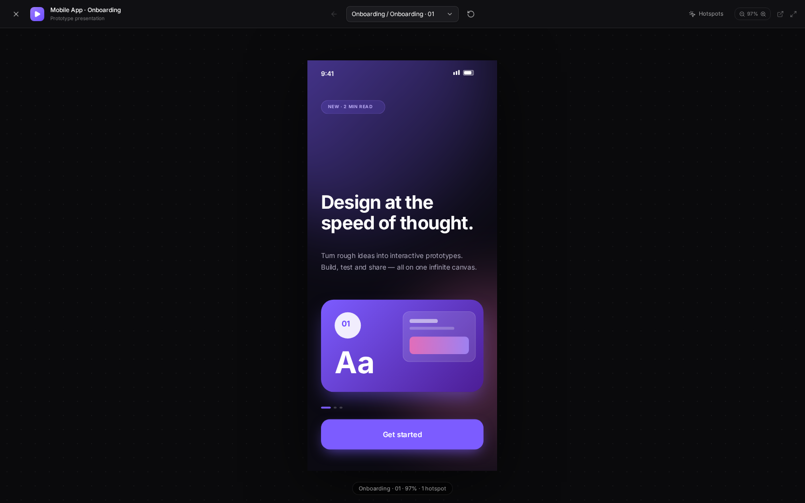
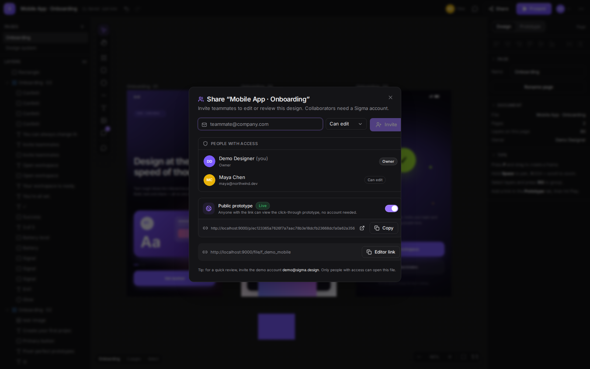
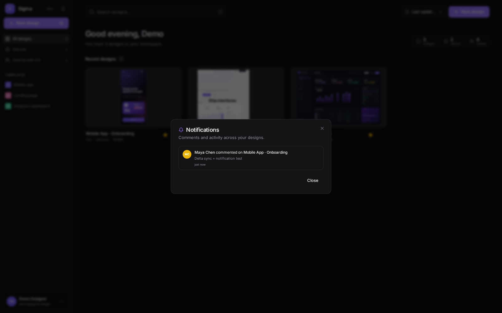
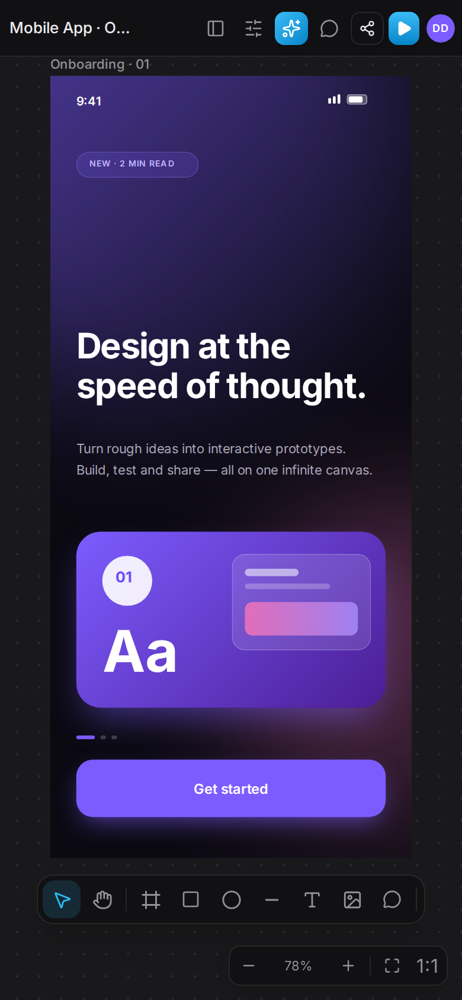
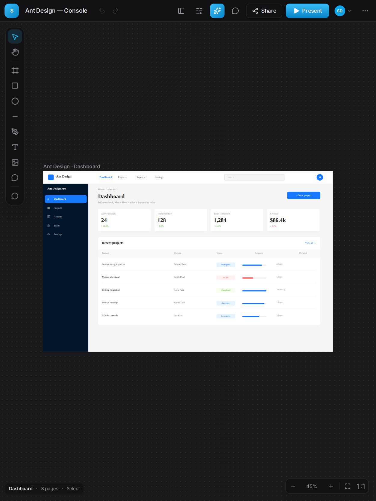

<div align="center">

# Sigma

**A Figma-inspired collaborative prototyping app.**

Infinite canvas · Layers & properties · Click-through prototypes · Real-time multiplayer · Comments · Version history

`Go` · `React 19` · `TypeScript` · `Tailwind CSS 4` · `shadcn/ui style components` · `SQLite` · `WebSocket`

</div>


## 功能

- **无限画布**：缩放、平移、点阵网格、框选、吸附辅助线、旋转、八向缩放。
- **设计工具**：Frame、矩形、椭圆、直线、文本、图片上传（服务端存储）、分组 / 取消分组。
- **图层树**：展开折叠、重命名、显示隐藏、锁定、拖拽排序与跨 Frame 拖拽、右键菜单。
- **属性面板**：位置尺寸、透明度、圆角、纯色 / 线性渐变填充、描边、阴影、模糊、字体排版、图片填充方式，以及对齐 / 分布。
- **原型演示**：给任意图层设置点击交互（跳转 Frame、返回、打开 URL）、过渡动画与热区，一键全屏演示。
- **公开原型链接**：无需账号即可通过 `/p/:token` 查看完整点击流程，适合快速用户测试与分享。
- **实时协作**：WebSocket 在线状态、多人光标、选区高亮、自动保存、离线重连补拉。
- **增量同步**：首次加载后只传输变化的页面 / 节点 / 墓碑，小操作不再上传整份文档。
- **评论**：在画布任意位置钉评论、定位图层、解决 / 重新打开、删除，查看者也可评论；新评论实时推送并生成站内通知。
- **版本历史**：命名保存快照、恢复，并把恢复结果实时广播给协作者。
- **文件与权限**：登录注册、文件列表 / 搜索 / 收藏、模板、复制、重命名、删除、邀请协作者（可编辑 / 仅查看）。
- **导出**：PNG / SVG 下载、复制为 PNG、系统深浅色主题。
- **手机 / 平板适配**：编辑器侧栏自动收进抽屉，底部触控工具栏，单指平移、双指缩放，触控友好的缩放手柄；文件面板、评论、分享、原型演示均已响应式适配。
- **中英文界面**：内置轻量 i18n，跟随浏览器语言，可在登录页、文件面板和编辑器账号菜单中切换；主色采用天蓝。
- **内置模板**：移动端 Onboarding、SaaS Landing Page、Analytics Dashboard，均带可点击原型链路。

| 文件面板 | 协作编辑器 |
| --- | --- |
|  |  |

| 原型演示 | 分享与公开链接 |
| --- | --- |
|  |  |

| 公开原型 | 通知中心 |
| --- | --- |
|  |  |

| 手机端 | 平板端 |
| --- | --- |
|  |  |

## 技术栈

| 层 | 技术 |
| --- | --- |
| 前端 | React 19, TypeScript, Vite 7, Tailwind CSS 4, Radix primitives + shadcn 风格组件, zustand, lucide-react, html-to-image, sonner |
| 后端 | Go 1.24+, `net/http` 路由, gorilla/websocket, SQLite (modernc.org/sqlite 纯 Go 驱动), JWT (golang-jwt), bcrypt |
| 存储 | 文件文档以 JSON 存储，节点级 LWW 合并；图片以 Data URL 内嵌 |

## 快速开始

要求：**Go 1.24+**、**Node.js 20+**、**pnpm 10+**。

```bash
# 1. 安装前端依赖
cd frontend
pnpm install
cd ..

# 2. 启动后端（默认 :9000，会自动创建 SQLite 并写入演示数据）
cd backend
go run .
# 或者：make backend
```

另开一个终端：

```bash
cd frontend
pnpm dev
# 或者：make frontend
```

打开 <http://localhost:5173>，Vite 会把 `/api`（含 WebSocket）代理到 `localhost:9000`。

### 演示账号

| 邮箱 | 密码 |
| --- | --- |
| `demo@sigma.design` | `demo1234` |

也可以直接点击登录页的 **Explore the demo workspace**，或注册新账号从模板开始。

### 生产模式（单二进制）

```bash
make build          # 构建前端 + Go 二进制
make run            # 默认 PORT=9000，静态目录 frontend/dist
```

或手动：

```bash
cd frontend && pnpm build
cd ../backend && go build -o ../sigma-server .
STATIC_DIR=../frontend/dist PORT=9000 ../sigma-server
```

### Docker

```bash
docker build -t sigma .
docker run --rm -p 9000:9000 -v sigma-data:/app/data sigma
```

打开 <http://localhost:9000>。

## 环境变量

| 变量 | 默认值 | 说明 |
| --- | --- | --- |
| `PORT` | `9000` | 后端监听端口 |
| `DB_PATH` | `data/sigma.db` | SQLite 文件路径 |
| `SIGMA_SECRET` | 开发用默认值 | JWT 签名密钥，生产环境必须替换 |
| `UPLOAD_DIR` | 与数据库同级的 `uploads/` | 图片与资源文件存储目录 |
| `STATIC_DIR` | 自动探测 `frontend/dist` | 生产环境前端静态目录 |
| `VITE_API_PROXY` | `http://localhost:9000` | Vite 开发代理目标（可选） |

## 目录结构

```text
sigma/
├── backend/
│   ├── main.go                  # 配置、静态托管、演示数据
│   └── internal/
│       ├── api/                 # HTTP handlers、鉴权、归档
│       ├── auth/                # JWT + bcrypt
│       ├── doc/                 # 文档合并、墓碑、版本恢复
│       ├── model/               # API 模型
│       ├── store/               # SQLite 数据访问
│       ├── templates/           # 内嵌模板 JSON
│       └── ws/                  # WebSocket 房间、在线状态广播
├── frontend/
│   ├── scripts/gen-templates.ts # 重新生成后端内嵌模板
│   └── src/
│       ├── components/editor/   # Canvas、图层、属性、预览、评论、分享…
│       ├── components/ui/       # shadcn 风格基础组件
│       ├── hooks/               # 实时协作 hook
│       ├── lib/                 # 类型、节点几何/矩阵、合并、API client
│       ├── pages/               # 登录、文件面板、编辑器
│       └── store/               # zustand 编辑器状态、鉴权、主题
└── docs/screenshots/
```

## 协作模型

没有引入 CRDT 库，而是针对原型文档实现了一套轻量的 **节点级 LWW（last-writer-wins）**：

1. 每个 `SceneNode` 带 `ts`；每次修改节点都会更新 `ts`。
2. 删除会写入 `doc.tombstones[nodeId]`；删除页面写入 `doc.deletedPages[pageId]`。
3. 前端本地修改后 **650ms 防抖**，与上次已发送版本做 diff，只通过 WebSocket 发送变化的节点、页面元数据和墓碑（`delta`）；图片在插入前已上传为 URL，不再进入文档 JSON。
4. 后端把 delta 合并进当前文档（同样的 `ts` / `tombstones` 规则），递增版本号并写入 SQLite，再把“权威 delta”（包含冲突胜利者）广播给房间内所有客户端。
5. 前端收到广播后再做一次同样的合并，因此本地未发送的修改不会被覆盖。
6. WebSocket 断开时自动降级为 HTTP `PUT /api/files/{id}/doc`；重连时先 `GET doc` 补拉，再发送本地未同步修改。
7. 撤销 / 重做会把恢复的快照与当前文档做 diff：修改过的节点提升 `ts`，消失的节点补墓碑，避免「撤销后被服务器合并复活」。
8. 版本恢复会把快照内所有节点 `ts` 提升到当前时间，并为当前存在但快照中不存在的节点写墓碑，因此恢复结果对所有协作者生效。

在线状态（光标、选区）走独立的 `presence` 消息，节流约 45ms，不写入数据库。

## 主要 API

| 方法 | 路径 | 说明 |
| --- | --- | --- |
| `POST` | `/api/auth/register` · `/api/auth/login` | 注册 / 登录，返回 JWT |
| `GET` | `/api/auth/me` | 当前用户 |
| `GET/POST` | `/api/files` | 文件列表 / 新建（模板） |
| `GET/PATCH/DELETE` | `/api/files/{id}` | 文件详情、重命名、收藏、缩略图、删除 |
| `POST` | `/api/files/{id}/duplicate` | 复制文件 |
| `GET/PUT` | `/api/files/{id}/doc` | 读取 / 合并保存文档 |
| `GET/POST` | `/api/files/{id}/versions` | 版本列表 / 保存快照 |
| `POST` | `/api/files/{id}/versions/{versionId}/restore` | 恢复版本并广播 |
| `GET/POST` | `/api/files/{id}/comments` | 评论列表 / 新建 |
| `PATCH/DELETE` | `/api/comments/{id}` | 解决 / 删除评论 |
| `GET/POST/DELETE` | `/api/files/{id}/members` | 协作者管理 |
| `POST` | `/api/uploads` | 上传图片（PNG / JPG / GIF / WebP，≤10 MB） |
| `GET` | `/api/uploads/{name}` | 读取已上传图片（随机文件名） |
| `GET/POST` | `/api/files/{id}/public-link` | 查询 / 开启关闭公开原型链接（仅 Owner） |
| `GET` | `/api/public/{token}` | 无需登录读取公开原型文档 |
| `GET` | `/api/notifications` | 当前用户通知列表与未读数 |
| `POST` | `/api/notifications/read` | 全部标记已读 |
| `GET` | `/api/ws?fileId=&token=&clientId=` | WebSocket 协作通道 |
| `GET` | `/api/templates` | 模板元数据 |

## 快捷键

| 操作 | 快捷键 |
| --- | --- |
| 移动 / 手型 / Frame / 矩形 / 椭圆 / 直线 / 文本 / 评论 | `V` `H` `F` `R` `O` `L` `T` `C` |
| 撤销 / 重做 | `⌘Z` / `⇧⌘Z` |
| 复制 / 粘贴 / 复制图层 | `⌘C` / `⌘V` / `⌘D` |
| 分组 / 取消分组 | `⌘G` / `⇧⌘G` |
| 删除 / 方向键微调 / `⇧` 加速 | `⌫` / `←↑→↓` / `⇧+方向键` |
| 缩放 | `⌘ + 滚轮`、`+` / `-` |
| 适应画布 / 100% | `⇧1` / `⇧0` |
| 平移 | `Space` + 拖拽、中键拖拽、`H` |

完整列表可在编辑器右上角 **⋯ → Keyboard shortcuts** 查看。

## 路线图：从设计工具到 Agent 平台

下一阶段围绕「超越 Figma」的能力建设：

- **BYOK + DeepSeek + Go ADK**：用户自带模型 Key，DeepSeek 默认使用最新 `deepseek-chat`；通过 Go ADK 提供可调用设计工具的 Agent，支持自然语言生成 / 修改画板、组件、文案与原型跳转。
- **OIDC**：企业 SSO，支持任意标准 OpenID Connect Provider。
- **MCP**：把 Sigma 的文件、图层、原型和导出能力暴露为 MCP Server，供 Claude / Cursor / 自研 Agent 调用。
- **Figma 互通**：Figma REST API 导入 + Figma 插件 / JSON 导出，避免不可靠的封闭 `.fig` 二进制解析。
- **更深的设计系统**：约束、组件实例、Design Tokens 与生产代码双向同步。

## 已知限制

- 定位是「可用的原型设计工具」，不是 Figma 的完整替代品：暂无矢量路径编辑、组件实例、Auto Layout、变体、插件系统。
- 协作合并粒度为整节点，同一节点的高频并发编辑以时间戳较晚者为准；文本没有字符级 CRDT。网络同步已改为增量 delta，但持久化仍会重写整份文档。
- 图片已改为服务端文件存储（`/api/uploads/...`），但暂时没有资源回收 / 引用计数；公开链接的图片 URL 为不可枚举的随机地址。
- 版本恢复与撤销已做墓碑/时间戳处理，但页面级并发（同一时刻新增/删除页面）仍可能以 LWW 结果为准；通知目前只有站内列表，没有邮件 / 推送。
- 桌面端体验最佳；手机与平板支持画布浏览、触控操作、图层 / 属性抽屉、评论与原型演示，但复杂的多图层排版仍建议使用桌面端。

## 开发提示

- 修改内置模板后执行 `cd frontend && pnpm gen:templates`，把 JSON 写入 `backend/internal/templates/`，然后重新编译后端。
- 数据库可随时删除 `backend/data/sigma.db*`；启动时会自动重新写入 demo 用户与三个示例文件。
- `make clean` 会删除构建产物和本地数据库。

---

用 Go 与 React 手写的一个小而完整的协作设计工具。祝玩得开心。
